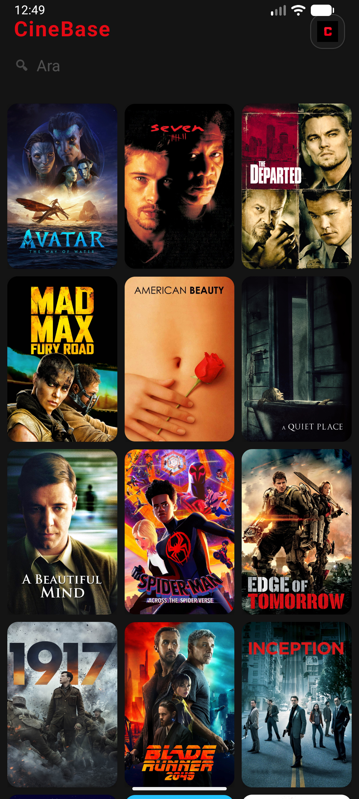
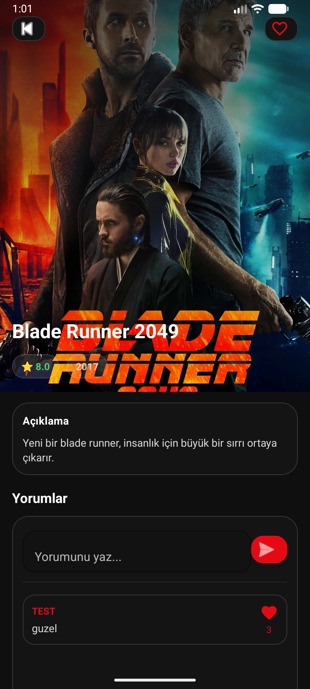
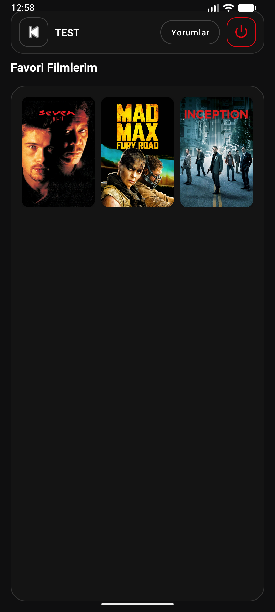
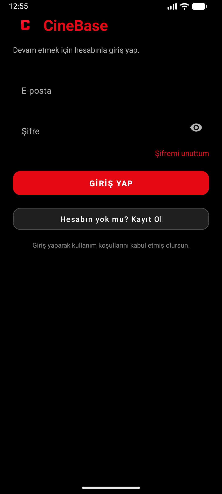

# CineBase

CineBase, filmleri keşfetmek, favorilere eklemek ve filmler hakkında yorum paylaşmak için geliştirilmiş bir Android uygulamasıdır. Film bilgileri Cloud Firestore üzerinden alınır; kullanıcı hesapları Firebase Authentication ile yönetilir.

**İlk geliştirme tarihi:** 4 Ocak 2026

## Özellikler

- Film afişlerini listeleme ve film detaylarını görüntüleme
- Film adı, açıklaması ve çıkış yılına göre arama
- E-posta ve şifre ile kayıt olma ve giriş yapma
- Filmleri favorilere ekleme ve favorilerden çıkarma
- Yorum yazma, kendi yorumlarını silme ve yorumları beğenme
- Profil ekranında favorileri ve kişisel yorumları görüntüleme
- Koyu arayüz

## Kullanılan teknolojiler

- Kotlin
- XML arayüzleri, AndroidX AppCompat ve ConstraintLayout
- RecyclerView ve Material Components
- Firebase Authentication ve Cloud Firestore
- Glide
- Gradle Kotlin DSL

## Kurulum

1. Depoyu indirin veya klonlayın ve Android Studio ile proje kök klasörünü açın.
2. Android SDK Manager üzerinden Android SDK Platform 37'yi yükleyin.
3. Aşağıdaki Firebase bağlantısını tamamlayın.
4. Gradle senkronizasyonunu çalıştırın.
5. Android 7.0 (API 24) veya üzeri bir cihaz ya da emülatör seçerek uygulamayı çalıştırın.

Proje Gradle Wrapper içerir. Mevcut yapılandırma Android Gradle Plugin 9.4.1 ve Gradle 9.6.0 kullanır. Gradle daemon JVM yapılandırması Java 25 ister.

### Firebase bağlantısı

Firebase yapılandırma dosyası bu depoya dahil edilmemiştir. Uygulamayı kendi verilerinizle çalıştırmak için:

1. [Firebase Console](https://console.firebase.google.com/) üzerinden bir proje açın.
2. Projeye paket adı `com.example.cinebase` olan bir Android uygulaması ekleyin veya bu paket adına sahip mevcut uygulamayı seçin.
3. `google-services.json` dosyasını indirip `app/google-services.json` konumuna yerleştirin.
4. Authentication bölümünde **Email/Password** giriş yöntemini etkinleştirin.
5. Cloud Firestore veritabanını oluşturun veya mevcut veritabanını kullanın. Erişim kurallarını uygulamanın kullanıcı yetkilerine göre yapılandırın.
6. Film belgelerini `Movie` koleksiyonuna ekleyin. Koleksiyon ve alan adları büyük/küçük harfe duyarlıdır.

Google Services Gradle eklentisi ve gerekli Firebase bağımlılıkları projede tanımlıdır.

Örnek film belgesi:

```json
{
  "movieName": "Örnek Film",
  "movieImageUrl": "https://example.com/poster.jpg",
  "movieDescription": "Filmin kısa açıklaması.",
  "movieRating": 8.2,
  "releaseYear": 2026
}
```

`movieImageUrl` alanı erişilebilir bir afiş adresi olmalıdır. `documentId`, film belgesi okunduğunda uygulama tarafından atanır.

Uygulamanın kullandığı temel Firestore yolları:

```text
Movie/{movieId}
Movie/{movieId}/Comments/{commentId}
Users/{userId}/Favorites/{movieId}
Users/{userId}/MyComments/{commentId}
```

### Debug APK oluşturma

Windows'ta proje klasöründe:

```powershell
.\gradlew.bat :app:assembleDebug
```

APK çıktısı: `app/build/outputs/apk/debug/app-debug.apk`

## Proje yapısı

```text
app/src/main/
  java/com/example/cinebase/  # Ekranlar, adaptörler ve veri modelleri
  res/                       # XML ekranları, temalar ve görseller
  AndroidManifest.xml
design/                      # Düzenlenebilir SVG logo
gradle/                      # Sürüm kataloğu ve Gradle Wrapper
```

## Ekran görüntüleri

<table>
  <tr>
    <th>Filmleri keşfet</th>
    <th>Detayları incele, yorum paylaş</th>
  </tr>
  <tr>
    <td align="center"></td>
    <td align="center"></td>
  </tr>
  <tr>
    <th>Favorilerini bir arada tut</th>
    <th>Hesabınla giriş yap</th>
  </tr>
  <tr>
    <td align="center"></td>
    <td align="center"></td>
  </tr>
</table>
